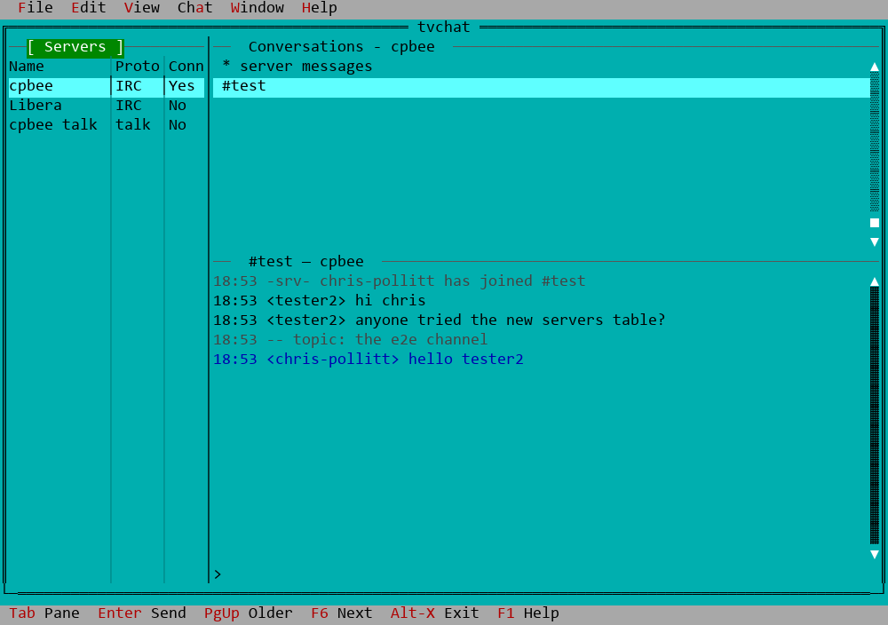

# tvchat

A chat client for the text terminal, wearing the face of Borland's Turbo
Vision: drop-down menus, shadowed dialogs, the cyan desktop, F10 for the menu
bar. IRC today (with the IRCv3 extensions a modern server offers); Delta Chat,
chat carried over email, is next.

It is tvmail's sibling: the same look and the same split. The C++ front end
draws windows. Everything protocol-specific (sockets, TLS, SASL, parsing)
lives in a stdlib-only Python helper, `tvchat-backend`, which tvchat keeps
running as a co-process. The two apps share their common C++ in
[`../tvcommon`](../tvcommon).



## The window

- **Servers (left):** a table, `Name | Proto | Conn`: each account with its unread
  count, its protocol (`IRC`, `talk`) and whether it is connected (`Yes`, `No`;
  `...` while connecting, `Err` after an error).
- **Conversations (top right):** the highlighted account's, starting with
  its server messages (MOTD, notices, SASL results), then channels and
  people.
- **The chat (bottom right):** the conversation picked, its log over the
  input line. Enter sends; PgUp at the top of the log fetches older lines
  (from the server too, when it keeps history - IRCv3 `chathistory`, as
  Ergo does). A line can be a command: `/me`, `/join`, `/part`, `/msg`,
  `/nick`, `/topic`, `/quote`; the server messages take commands only.

**talk(1)** too (`protocol = talk`): through the one talkd on the LAN master
(chrispollitt/POSIX `chat-setup`), so a plain `talk you@cpbee` from any shell
rings you in tvchat. Chat > Join... calls, Enter answers, Chat > Leave hangs
up. A talk conversation has two views, View > Talk view (Ctrl-T): *classic*,
talk's own split screen in the chat pane with every keystroke sent (the
default), or *IRC*, the log with whole lines and "... is typing".

A lost connection comes back by itself: tvchat pings a quiet server, and
reconnects after 2 s, 4 s, 8 s ... up to 5 minutes, rejoining its channels.
What you send is paced (a burst of 5 lines, then 2 a second), so a long
paste does not get you thrown off the server.

Tab moves servers → conversations → input. As in tvmail, moving a highlight
shows what it points at, and a conversation counts as read once the chat pane
has the focus. Unsent text stays with its conversation; Alt-X asks before it
is thrown away.

The menus and the key line follow tvmail's: File ▸ Reload (`F5`) and Exit
(`Alt-X`), Chat (`Alt-C`, where tvmail has Message), Edit, View, Window (Next,
Previous, Zoom, Tile, Cascade, List `Alt-0`, Redraw, Close), Help; the key line
ends `F5 Reload  F6 Next  Alt-X Exit  F1 Help` in both apps.

Ctrl-L (Window ▸ Redraw screen) repaints the whole screen. While tvchat
runs, its terminal takes no messages - it clears the terminal's group-write
bit, as `mesg n` does - so `talk` requests and `write` / `wall` messages from
ordinary users don't land on top of the window; the mode goes back on exit,
while a command run from it has the terminal, and while it is stopped. Root's
messages (`wall` run by root, shutdown notices) still get through: Ctrl-L
clears them. `mesg = y` under `[ui]` in `tvchat.conf` keeps taking messages.

## Quick start

```sh
./build.sh                      # fetches + patches Turbo Vision, builds
./install.sh                    # /usr/local (sudo if needed)
cp configure/tvchat.conf.example ~/.config/tvchat/tvchat.conf   # then edit
tvchat
```

Passwords never go in `tvchat.conf`: `$TVCHAT_PASS_<ACCOUNT>`,
`~/.mu-tickets` or `~/.netrc`, for the SASL login. For your own IRC server on
the LAN, `chrispollitt/POSIX`'s `chat-setup` installs Ergo
(`configure-ergo.sh`) and points tvchat at it (`configure-tvchat.sh`). See
[INSTALL.md](INSTALL.md).

## Files

| path | what |
| --- | --- |
| `src/` | the C++ front end: `main.cpp`, `app.cpp`, `chat.cpp` (the client side of the backend), `chatwin.cpp` (the window and the Chat menu) |
| `backend/tvchat-backend` | the Python helper (`man tvchat-backend`) |
| `configure/tvchat.conf.example` | a commented configuration |
| `tests/` | `./test.sh` runs them all (see [tests/README.md](tests/README.md)) |
| `HANDOFF.md` | the plan, what has been built, and the decisions made since |
| `BUGS.md` | the bug list |
